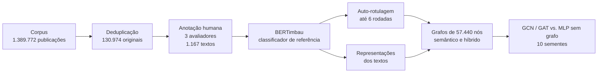
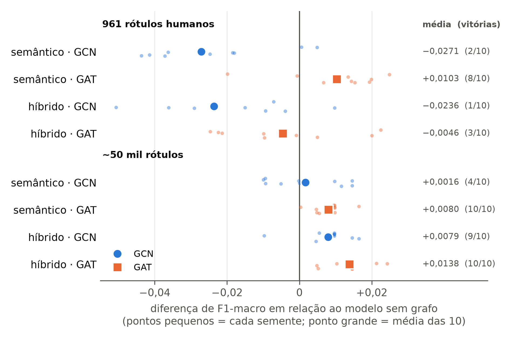

# Detecção de Discurso de Ódio Político em Redes Sociais por meio de Redes Neurais em Grafos

Trabalho de Conclusão de Curso — Bacharelado em Ciência da Computação
Faculdade de Computação e Informática (FCI) — Universidade Presbiteriana Mackenzie — 2026

**Autores:** Carlos Eduardo Hayashi, Edson Luiz Cardoso Ohira e Vinicius Oliveira Piccazzio
**Orientador:** Prof. Ivan Carlos Alcantara de Oliveira

---

## Sumário

- [Sobre o projeto](#sobre-o-projeto)
- [Metodologia](#metodologia)
- [Principais resultados](#principais-resultados)
- [Estrutura do repositório](#estrutura-do-repositório)
- [Configuração dos experimentos](#configuração-dos-experimentos)
- [Como executar](#como-executar)
- [Dados e ética](#dados-e-ética)
- [Limitações](#limitações)
- [Como citar](#como-citar)

## Sobre o projeto

O trabalho investiga se a **estrutura de vizinhança entre textos**, representada como grafo, melhora a detecção de discurso de ódio político em português. O corpus reúne publicações do X (antigo Twitter) sobre a invasão das sedes dos Três Poderes em 8 de janeiro de 2023.

A pergunta central é se uma rede neural em grafos (GCN ou GAT) supera um modelo que recebe **as mesmas representações de texto, mas sem as arestas**. Assim, qualquer ganho observado pode ser atribuído ao grafo, e não à qualidade dos vetores.

## Metodologia



1. **Corpus:** 1.389.772 publicações em português; após remover republicações e duplicatas, 130.974 textos originais.
2. **Anotação:** amostra aleatória rotulada por três avaliadores (ódio político / não ódio), com rótulo final por maioria (pelo menos dois de três), seguindo o [manual de anotação](docs/Manual_Anotacao_Odio_Politico.pdf). Base final de 1.167 textos: 811 de treino, 150 de validação e 206 de teste congelado, nunca usados em treino nem na escolha de configurações.
3. **Classificador de referência:** BERTimbau base (`neuralmind/bert-base-portuguese-cased`), com as oito camadas inferiores congeladas e as quatro superiores ajustadas.
4. **Auto-rotulagem:** ciclo iterativo de pseudo-rotulagem, com limiares de confiança calibrados na validação para uma precisão mínima de 90%.
5. **Grafos:** dois grafos de 57.440 nós — **semântico** (kNN pela similaridade dos textos) e **híbrido** (similaridade + relações de conversa e autoria). GCN e GAT foram comparadas a um MLP sem grafo, com 961 rótulos humanos e com cerca de 50 mil rótulos (humanos + pseudo-rótulos), em 10 sementes.

## Principais resultados

**Concordância entre anotadores (1.396 textos):** concordância bruta de 0,7752, Kappa de Fleiss de 0,4373 e AC1 de Gwet de 0,6257. A concordância é apenas parcial, o que reflete a subjetividade da fronteira entre ódio político e crítica política veemente.

**Classificador de referência:** F1-macro de **0,8106** no teste, treinado só com os 811 textos anotados. A auto-rotulagem não superou esse modelo em nenhuma das seis rodadas.

**Grafos (F1-macro no teste, média de 10 sementes):**

| Rótulos | Estrutura | Modelo | F1-macro | Diferença vs. sem grafo | Vitórias |
|---|---|---|---|---|---|
| 961 humanos | sem grafo | MLP | 0,7788 | — | — |
| 961 humanos | semântica | GAT | 0,7891 | +0,0103 | 8/10 |
| 961 humanos | híbrida | GAT | 0,7742 | −0,0046 | 3/10 |
| ~50 mil | sem grafo | MLP | 0,8026 | — | — |
| ~50 mil | semântica | GAT | 0,8106 | +0,0080 | 10/10 |
| ~50 mil | híbrida | GCN | 0,8105 | +0,0079 | 9/10 |
| ~50 mil | híbrida | **GAT** | **0,8164** | **+0,0138** | **10/10** |

Com poucos rótulos, o grafo não traz ganho consistente. Com cerca de 50 mil nós rotulados, todas as configurações com grafo superam o modelo sem grafo na média, e a **GAT sobre o grafo híbrido** obtém o melhor resultado, à frente em todas as dez sementes. A tabela completa, com as oito configurações, está no artigo.

<p align="center">
  
</p>

## Estrutura do repositório

```
docs/        manual de anotação (PDF)
src/         scripts de preparação dos dados, tabelas e figuras (ver src/README.md)
results/     log de extração do corpus, métricas de concordância e tabelas de resultados (JSON)
figuras/     figuras dos resultados e do grafo
data/        dados (não versionados — corpus confidencial)
```

## Configuração dos experimentos

| Componente | Configuração |
|---|---|
| BERTimbau | 4 camadas superiores ajustadas; textos de até 128 tokens; lotes de 16; taxa de aprendizado 2 × 10⁻⁵; decaimento de peso 0,01; aquecimento de 10%; AdamW; parada antecipada (paciência 2) pelo F1-macro na validação |
| Auto-rotulagem | até 6 rodadas, 2 sementes por rodada; grade de limiares {0,90; 0,95; 0,97; 0,99; 0,995}; precisão mínima de 90% na validação; seleção balanceada, até 40.000 textos por classe |
| Grafo semântico | kNN com k = 5 pelo cosseno da média dos vetores dos tokens |
| Arestas de interação | mesma conversa ou mesmo autor, até 3 vizinhos anteriores e 3 posteriores em ordem cronológica |
| GCN / GAT / MLP | 2 camadas de 128 unidades; dropout 0,5; Adam (taxa 0,01, decaimento 5 × 10⁻⁴); 200 épocas; pesos por classe; GAT com 4 cabeças |
| Sementes | 42, 7, 2024, 1, 13, 99, 256, 777, 31337 e 5 |

Ambiente: Python, PyTorch, Hugging Face Transformers e PyTorch Geometric, no Google Colab com GPU NVIDIA T4.

## Como executar

1. Instale as dependências: Python 3.12, pandas, numpy, matplotlib, PyTorch, Hugging Face Transformers e PyTorch Geometric.
2. Coloque os dados no diretório indicado pela variável `BASE_DIR` / `BASE` no início de cada script (o corpus não é distribuído; ver [`data/README.md`](data/README.md)).
3. Execute os scripts de `src/` na ordem da tabela em [`src/README.md`](src/README.md).

## Dados e ética

O corpus foi cedido pelo CIBERDEM e é **confidencial**: nenhum texto, identificador de usuário ou rótulo individual é publicado neste repositório. Nenhum texto real é reproduzido aqui ou no artigo; os exemplos do manual de anotação são sintéticos.

## Limitações

- A concordância entre anotadores é parcial, o que introduz incerteza nos rótulos de referência.
- O teste tem 206 textos e a validação, 150, de modo que diferenças pequenas de F1-macro devem ser lidas com cautela.
- A base balanceada tem 49,4% de ódio político, proporção superior à do corpus original.
- Os pseudo-rótulos têm ruído estimado em cerca de 10%, e apenas 46 dos 206 nós de teste têm arestas de conversa ou autoria.
- Os experimentos com GNNs são transdutivos; o desempenho em textos novos (cenário indutivo) não foi avaliado.
- Todos os textos pertencem a uma única coleção, sobre um mesmo episódio político.

## Como citar

HAYASHI, Carlos Eduardo; OHIRA, Edson Luiz Cardoso; PICCAZZIO, Vinicius Oliveira. **Detecção de Discurso de Ódio Político em Redes Sociais por meio de Redes Neurais em Grafos**. Trabalho de Conclusão de Curso (Bacharelado em Ciência da Computação) — Faculdade de Computação e Informática, Universidade Presbiteriana Mackenzie, São Paulo, 2026.

```bibtex
@misc{hayashi2026odio,
  author       = {Hayashi, Carlos Eduardo and Ohira, Edson Luiz Cardoso and Piccazzio, Vinicius Oliveira},
  title        = {Detecção de Discurso de Ódio Político em Redes Sociais por meio de Redes Neurais em Grafos},
  howpublished = {Trabalho de Conclusão de Curso (Bacharelado em Ciência da Computação), Universidade Presbiteriana Mackenzie},
  year         = {2026},
  url          = {https://github.com/EdsonOhira/tcc-odio-politico}
}
```
